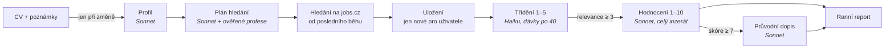

# Job Scout

*[English version](README.md)*

**AI asistent pro hledání práce postavený na .NET 10 a Claude.** Každé ráno projde pracovní portály a najde
inzeráty, které odpovídají tvému CV. Odfiltruje šum, zbytek ohodnotí vůči tvému profilu a k nejlepším nabídkám
napíše návrh průvodního dopisu. **AI předvybírá, člověk rozhoduje – nic se neodesílá automaticky.**

Vznikl jako způsob, jak se naučit prakticky pracovat s AI na skutečném problému, mém vlastním hledání práce.
Pak se z něj stal nástroj, který denně používám.

> **Stav:** fáze 1–4 jsou hotové a v denním provozu (konzolový worker + ranní HTML report, spouštěný Plánovačem
> úloh Windows). Dál: webové API s přihlášením přes Microsoft/Google, Angular UI, nasazení do Azure.
> Viz [Plán](#plán).

## Co umí

1. **Jednou přečte CV a poznámky.** Claude udělá z CV (PDF/Markdown) a volných preferencí („full remote,
   min. 95 tis., ne Java“) strukturovaný profil. Znovu se volá, jen když se CV nebo poznámky změní.
2. **Naplánuje hledání.** AI navrhne profese z katalogu portálu a každý návrh se ověří přímo na webu.
   Ověřené názvy si aplikace pamatuje v naučeném katalogu, takže další běhy nic nestojí.
3. **Hledá denně.** Stahuje jen inzeráty od posledního úspěšného běhu (24 h / 3 dny). Inzerát se uloží jednou,
   sdíleně pro všechny uživatele. Co už uživatel viděl, se přeskočí.
4. **Třídění (levný model).** Titulky jdou po dávkách 40 kusů a dostanou relevanci 1–5. Vyřadí se jen zjevně
   nesouvisející.
5. **Hodnocení (chytrý model).** Stáhne se celý inzerát. Výsledkem je skóre 1–10, důvody, rizika, otázky na
   pohovor, mzda, home office a forma spolupráce. Neznámé není špatné: neuvedená mzda je otázka, ne penalizace.
6. **Průvodní dopisy** ke každé nabídce se skóre 7 a víc, česky, z profilu a inzerátu.
7. **Ranní report.** Samostatná HTML stránka ukáže dnešní doporučení s tlačítkem „kopírovat dopis“, dřívější
   doporučení bez reakce a hraniční nabídky, které čekají na tvoje rozhodnutí.

Každé volání AI se eviduje i s tokeny a cenou. Typický běh za 3 dny stojí asi **0,36 $**, denní běh méně.



## Architektura

**Modulární monolit** s porty a adaptéry ([ADR-0002](docs/adr/0002-modular-monolith.md),
[ADR-0003](docs/adr/0003-layering-ports-and-adapters.md)). Závislosti vedou jen dovnitř. Hlídají to
architektonické testy při každém buildu.

| Projekt | Odpovědnost | Závisí na |
| --- | --- | --- |
| `JobScout.Core` | Doména: `User`, `UserProfile`, `JobOffer` (sdílená), `JobMatch` (pro uživatele, s historií stavů), `ScoutRun`, `LlmCall` | ničem |
| `JobScout.Application` | Případy užití (`AnalyzeProfile`, `PlanSearch`, `TriageJobs`, `EvaluateJobs`, `WriteCoverLetters`, `BuildMorningReport`…), porty (`ILlmClient`, `IJobSource`, `IAppDbContext`), prompty | Core, EF Core (základ) |
| `JobScout.Infrastructure` | Adaptéry: Claude (oficiální SDK `Anthropic`), jobs.cz (AngleSharp + záložní Playwright), EF Core + SQLite, HTML report | Application |
| `JobScout.Worker` | Hostitel: jednorázový běh, konfigurace, DI | vše |
| `JobScout.Tests` | xUnit: doména, případy užití s falešným LLM a zdrojem, parsery na fiktivním HTML, perzistence na skutečných migracích, pravidla architektury | – |

Co stojí za pozornost:

- **Vlastní úzký port na LLM** ([ADR-0004](docs/adr/0004-own-llm-port.md)). Aplikační vrstva nezná SDK dodavatele.
  *Úroveň* modelu (`Fast` = Haiku na třídění, `Smart` = Sonnet na profil, hodnocení a dopisy) se volí v konfiguraci.
- **Strukturovaný výstup** ([ADR-0005](docs/adr/0005-structured-ai-output.md)). Každý prompt má JSON Schema.
  Výsledek se parsuje a validuje, protože výstupu AI se slepě nevěří (rozsah skóre, neznámá id, useknuté dopisy).
- **Ochrana proti prompt injection.** CV a inzeráty jsou nedůvěryhodná data. Jdou do XML značek a prompt modelu
  říká, ať pokyny v nich ignoruje a nahlásí je jako riziko.
- **Pipeline řízená stavem.** `JobMatch` prochází `Found → Shortlisted | TriagedOut → Evaluated`. Po pádu nebo
  vyčerpání limitu pokračuje další běh, kde ten minulý skončil. Pořadí se řídí relevancí, takže nejlepší nabídky
  se hodnotí první.
- **Naučený katalog** ([ADR-0015](docs/adr/0015-jobscz-profession-resolution.md)). AI navrhne profesi, levný HTTP
  dotaz ověří, že existuje. Kladné i záporné odpovědi se pamatují 90 dní.
- **Evidence nákladů** ([ADR-0016](docs/adr/0016-llm-cost-tracking.md)). Dekorátor kolem `ILlmClient` zapíše každé
  volání (účel, model, tokeny, mikrodolary, trvání). Ambientní kontext (`AsyncLocal`) ho přiřadí uživateli a běhu.
- **Bohatý doménový model, EF Core napřímo** ([ADR-0008](docs/adr/0008-persistence-ef-core.md),
  [ADR-0010](docs/adr/0010-rich-domain-model.md)). Bez generického repozitáře a MediatR. Guid v7, `TimeProvider`,
  enumy jako text, migrace od prvního dne (teď SQLite, v Azure PostgreSQL).
- **Slušné stahování** ([ADR-0006](docs/adr/0006-job-source-scraping.md)). Jen veřejné stránky, jeden požadavek
  po druhém s prodlevou, nikdy interní API. Headless prohlížeč jen na kariérní stránky vykreslované JavaScriptem.

Všechna rozhodnutí včetně zamítnutých alternativ jsou v [docs/adr](docs/adr/README.md) (anglicky).

### Kde jsou prompty

Prompty leží u případu užití, který je používá, spolu s JSON Schema a typem výsledku, se kterými musí sedět:

| Krok | Prompt | Úroveň modelu |
| --- | --- | --- |
| Profil z CV | `Application/Profiles/ProfilePrompts.cs` | Smart |
| Návrh profesí | `Application/Jobs/CategoryPrompts.cs` | Smart |
| Třídění | `Application/Triage/TriagePrompts.cs` | Fast |
| Hodnocení | `Application/Evaluation/EvaluationPrompts.cs` | Smart |
| Průvodní dopis | `Application/Letters/CoverLetterPrompts.cs` | Smart |

Prompty a texty pro uživatele jsou česky (cílový trh). Kód, komentáře a dokumentace anglicky. Prompty jsou
**profesně neutrální**: mezi testovacími personami je autolakýrník a zedník, nejen vývojáři
([ADR-0014](docs/adr/0014-dev-sign-in-test-personas.md)).

## Lokální spuštění

Potřebuješ .NET 10 SDK a [API klíč Anthropic](https://console.anthropic.com/).

```bash
# API klíč – proměnná prostředí (nebo user secrets), nikdy do repozitáře
export ANTHROPIC_API_KEY=...          # Windows: setx ANTHROPIC_API_KEY ...

dotnet test                            # bez sítě a bez volání AI

cd src/JobScout.Worker
# 1) ohodnotí fiktivní ukázkové inzeráty vůči fiktivnímu CV
dotnet run -- --Scout:DataDir=samples
# 2) skutečné hledání na jobs.cz pro testovací personu; HTML report jde do Scout:ReportDir
#    (výchozí: reports/ vedle binárek) a otevře se v prohlížeči
dotnet run -- --Scout:Persona=zednik --Scout:Mode=search --Scout:OpenReport=true
```

Pro vlastní CV nastav `Scout:DataDir` na složku **mimo repozitář** s `cv.pdf` (nebo `cv.md`) a volitelně
`preferences.md`. Cestu k databázi dej do user secrets (`ConnectionStrings:JobScout`). Databáze se při startu
sama vytvoří a zmigruje.

## Plán

| Fáze | Obsah | Stav |
| --- | --- | --- |
| 1–2 | Napojení na Claude, profil z CV, hodnocení; zdroj jobs.cz se záložním prohlížečem | ✅ |
| 3 | Perzistence, případy užití, plán hledání, naučený katalog, deník běhů | ✅ |
| 4 | Třídění → hodnocení → dopisy, evidence nákladů, ranní report | ✅ denně v provozu |
| 5 | ASP.NET Core API, přihlášení (BFF) přes Microsoft/Google, pozvánky, nahrání CV, stavy | další |
| 6 | Angular UI: všechny protříděné nabídky, hodnocení a dopis na vyžádání, historie stavů | |
| 7 | Azure (Container Apps + plánovaná úloha, PostgreSQL, Key Vault), ranní e-mail | |
| později | Další zdroje (prace.cz, StartupJobs…), ručně přidané inzeráty ([ADR-0013](docs/adr/0013-manual-job-ads-private.md)), prompt caching | |

## Data a soukromí

- V repozitáři nejsou žádné klíče ani osobní údaje. CV, ukázkové inzeráty i HTML pro testy jsou **fiktivní**.
- Skutečná data (CV, databáze, reporty) jsou mimo repozitář.
- Aplikace nikdy sama nereaguje na inzerát ani nic neodesílá.
- Projekt nemá nic společného s jobs.cz ani LMC. Stahování je určené pro osobní použití v malém objemu
  a k webu se chová ohleduplně (jen veřejné stránky, omezená rychlost).

## Licence

[MIT](LICENSE) © 2026 Stanislav Matzke
