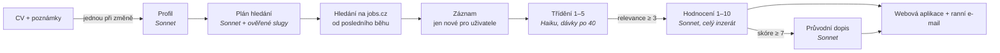
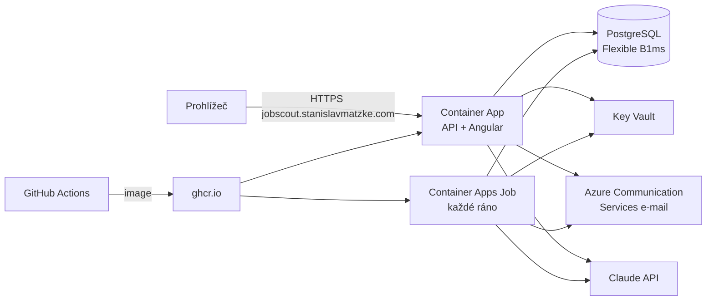

# Job Scout

[](https://github.com/stanislavmatzke-ops/job-scout/actions/workflows/ci.yml)
[](https://github.com/stanislavmatzke-ops/job-scout/actions/workflows/docker.yml)

*[English version](README.md)*

**AI asistent pro hledání práce postavený na .NET 10, Angularu a Claude.** Každé ráno projde pracovní portály
a najde inzeráty, které odpovídají vašemu CV. Odfiltruje šum, zbytek ohodnotí vůči vašemu profilu a k nejlepším
nabídkám napíše návrh průvodního dopisu. **AI předvybírá, člověk rozhoduje – nic se neodesílá automaticky.**

Vznikl jako způsob, jak se naučit prakticky pracovat s AI na skutečném problému – mém vlastním hledání práce.
Pak se z něj stal nástroj, který denně používám.

> **Naživo:** [jobscout.stanislavmatzke.com](https://jobscout.stanislavmatzke.com) – klikněte na
> **„Vyzkoušet bez registrace“** a prohlédněte si aplikaci jako ukázkový uživatel se skutečnými aktuálními inzeráty
> (AI funkce jsou v ukázce vypnuté). Běží v Azure (Container Apps, PostgreSQL), přihlášení přes Microsoft nebo Google,
> rozhraní česky a anglicky.

## Co umí

1. **Jednou přečte CV a poznámky.** Claude udělá z CV (PDF, Word, Markdown) a volných preferencí („full remote,
   min. 95 tis. Kč, žádná Java“) strukturovaný profil – v jazyce vašeho CV. Znovu se spustí, jen když se CV
   nebo poznámky změní.
2. **Naplánuje hledání.** AI navrhne profese pracovního portálu, které k profilu sedí. Každý návrh se ověří proti
   skutečnému webu. Ověřené názvy si pamatuje v naučeném katalogu, takže další běhy nestojí nic.
3. **Hledá denně.** Stahují se jen inzeráty zveřejněné od posledního úspěšného běhu (24 h / 3 dny).
   Inzerát se uloží jednou a sdílejí ho všichni uživatelé. Inzeráty, které už jste viděli, se přeskočí.
4. **Třídění (levný model).** Titulky se posílají po 40 a dostanou relevanci 1–5.
   Vyřadí se jen ty zjevně nerelevantní.
5. **Hodnocení (chytrý model).** Stáhne se celý inzerát. Následuje skóre shody 1–10, důvody, rizika a otázky
   pro zaměstnavatele, plus plat, práce na dálku a typ úvazku. Neznámé neznamená špatné: chybějící plat je otázka,
   ne penalizace. Hodnocení je v jazyce inzerátu (rozhoduje o tom kód, ne model).
6. **Průvodní dopisy** ke každé shodě se skóre 7 a víc, v jazyce inzerátu.
7. **Webová aplikace.** Nabídky v záložkách (k rozhodnutí / rozpracované / uzavřené / vyřazené), detail s hodnocením
   a dopisem od AI, stavy s historií a poznámkami; ohodnocení nebo (pře)napsání dopisu na vyžádání; stránka profilu
   ukazuje, „jak vás vidí AI“.
8. **E-maily.** Každé ráno krátký souhrn nových nabídek (lze vypnout), plus schválení/zamítnutí přístupu.
9. **Zpětná vazba.** Stránka „Zpětná vazba“ – zpráva se uloží a přijde autorovi e-mailem, odpovědět lze jedním kliknutím.

Každé volání AI se zaznamená i s tokeny a cenou. Běžný denní běh pro jednoho uživatele stojí pár centů. Co uživatel
spustí kliknutím, je omezené v rámci libovolných 24 hodin – vyhodnocení profilu, dopisy, hodnocení i celková cena – a
aplikace ukazuje, kolik zbývá ([ADR-0021](docs/adr/0021-ai-limits-for-clicks.md)).



## Přístup

Přihlásit se může kdokoli přes Microsoft nebo Google; nový účet **požádá o přístup** a správce ho schválí nebo zamítne
(s důvodem, e-mailem) – každý schválený účet stojí AI tokeny ([ADR-0017](docs/adr/0017-access-requests-admin-approval.md)).
Odkazy s pozvánkou frontu přeskočí. Správce vidí náklady na AI každého uživatele za posledních 7 a 30 dní a může účet
pozastavit. Veřejný **ukázkový účet** je jeden sdílený smyšlený uživatel: skutečné inzeráty, žádná AI pro návštěvníky,
každé ráno se vrátí do výchozího stavu ([ADR-0020](docs/adr/0020-public-demo-account.md)).

## Architektura

**Modulární monolit** s porty a adaptéry ([ADR-0002](docs/adr/0002-modular-monolith.md),
[ADR-0003](docs/adr/0003-layering-ports-and-adapters.md)). Závislosti míří dovnitř. Architektonické testy
to hlídají při každém buildu.

| Projekt | Odpovědnost | Reference |
| --- | --- | --- |
| `JobScout.Core` | Doména: `User` (přístup, zamítnutí, pozastavení), `UserProfile`, `JobOffer` (sdílený), `JobMatch` (pro uživatele, s historií stavů), `ScoutRun`, `LlmCall`, `Invitation` | nic |
| `JobScout.Application` | Use casy (`AnalyzeProfile`, `RunScout`, `EvaluateMatchNow`, `ApproveUser`…), porty (`ILlmClient`, `IJobSource`, `IEmailSender`, `IAppDbContext`), prompty, šablony e-mailů | Core, základ EF Core |
| `JobScout.Infrastructure` | Adaptéry: Claude (oficiální SDK `Anthropic`), jobs.cz (AngleSharp + Playwright), EF Core (lokálně SQLite, v Azure PostgreSQL), e-maily přes Azure Communication Services | Application |
| `JobScout.Migrations.Postgres` | Migrace pro PostgreSQL (ty pro SQLite jsou v Infrastructure) – [ADR-0018](docs/adr/0018-postgresql-in-azure-sqlite-locally.md) | Infrastructure |
| `JobScout.Api` | ASP.NET Core minimal API: BFF přihlášení cookie (OIDC Microsoft/Google), přístupové politiky, fronta na pozadí pro první hledání, servíruje Angular aplikaci | vše |
| `JobScout.Worker` | Ranní běh pro všechny schválené uživatele (v Azure jako Container Apps Job) | vše |
| `JobScout.Web` | Angular 21 (standalone, signals, zoneless, Material), čeština/angličtina | – |
| `JobScout.Tests` | xUnit: doména, use casy s falešným LLM/zdrojem inzerátů/e-mailem, API v paměti, parsery na smyšleném HTML, obě sady migrací, architektonická pravidla | – |

Rozhodnutí, která stojí za pozornost:

- **Vlastní úzký port na LLM** ([ADR-0004](docs/adr/0004-own-llm-port.md)). Aplikační kód nezná SDK dodavatele.
  *Úrovně* modelů (`Fast` = Haiku pro třídění, `Smart` = Sonnet pro profil, hodnocení a dopisy) se volí v konfiguraci.
- **Strukturovaný výstup** ([ADR-0005](docs/adr/0005-structured-ai-output.md)). Každý prompt má JSON Schema. Výsledky
  se parsují a validují, protože výstupu LLM se nikdy slepě nevěří (rozsahy skóre, neznámá id, useknuté dopisy).
- **Hygiena proti prompt injection.** CV a inzeráty jsou nedůvěryhodná data. Vkládají se do XML-like tagů a prompty
  modelu říkají, ať instrukce v nich ignoruje a nahlásí je jako riziko.
- **Pipeline řízená stavem.** `JobMatch` prochází `Found → Shortlisted | TriagedOut → Evaluated`. Po pádu nebo limitu
  další běh pokračuje tam, kde předchozí skončil – nejlepší inzeráty první.
- **Sledování nákladů** ([ADR-0016](docs/adr/0016-llm-cost-tracking.md)). Dekorátor kolem `ILlmClient` zaznamená každé
  volání (účel, model, tokeny, mikrodolary, doba). Ambientní kontext `AsyncLocal` ho přiřadí uživateli a běhu.
- **BFF přihlášení** ([ADR-0011](docs/adr/0011-authentication-bff.md)). Prohlížeč nikdy nevidí token: OIDC
  s Microsoftem/Googlem končí naší vlastní `__Host-` cookie; volání měnící stav vyžadují hlavičku `X-CSRF`. Stav přístupu
  se čte z databáze při každém požadavku, takže schválení nebo pozastavení platí okamžitě.
- **Bohatý doménový model, přímo EF Core** ([ADR-0008](docs/adr/0008-persistence-ef-core.md),
  [ADR-0010](docs/adr/0010-rich-domain-model.md)). Žádný generický repozitář, žádný MediatR. Id jako Guid v7,
  `TimeProvider`, enumy jako text, migrace od prvního dne.
- **Typované i18n bez knihovny.** Čeština je zdrojový slovník, angličtina je `typeof cs` – kompilátor odmítne chybějící
  překlad. Jazyk se řídí prohlížečem, volba uživatele se pamatuje.
- **Ohleduplný scraping** ([ADR-0006](docs/adr/0006-job-source-scraping.md)). Jen veřejné stránky, jeden požadavek
  po druhém s prodlevou, nikdy interní API.

Všechna rozhodnutí včetně zamítnutých alternativ jsou v [docs/adr](docs/adr/README.md).

### Hosting



Jeden Docker image (Angular + API + Worker + headless Chromium) sestavený v GitHub Actions; celé prostředí v Azure je
**infrastruktura jako kód** v [`infra/main.bicep`](infra/main.bicep) a nasazuje se jedním skriptem
([ADR-0019](docs/adr/0019-hosting-one-image-container-apps.md), [infra/README.md](infra/README.md)). Tajné hodnoty jsou
v Key Vaultu a čtou se přes managed identity; v repozitáři není nic osobního.

### Kde jsou prompty

| Krok | Prompt | Úroveň modelu |
| --- | --- | --- |
| Profil z CV | `Application/Profiles/ProfilePrompts.cs` | Smart |
| Návrhy profesí | `Application/Jobs/CategoryPrompts.cs` | Smart |
| Třídění | `Application/Triage/TriagePrompts.cs` | Fast |
| Hodnocení | `Application/Evaluation/EvaluationPrompts.cs` | Smart |
| Průvodní dopis | `Application/Letters/CoverLetterPrompts.cs` | Smart |

Prompty jsou česky (cílový trh); výstup se řídí jazykem zdroje (CV nebo inzerátu). Kód, komentáře a dokumentace jsou
anglicky. Prompty jsou **profesně neutrální**: mezi testovacími personami je lakýrník a zedník, nejen vývojáři
([ADR-0014](docs/adr/0014-dev-sign-in-test-personas.md)).

## Lokální spuštění

Potřebujete .NET 10 SDK, Node 22 (npm 11) a [Anthropic API klíč](https://console.anthropic.com/).

```bash
export ANTHROPIC_API_KEY=...          # Windows: setx ANTHROPIC_API_KEY ...   – nikdy do repozitáře

dotnet test                            # bez sítě, bez volání LLM
cd src/JobScout.Web && npm ci && npm test

# API (https://localhost:7283, soubor SQLite, vývojové přihlášení s testovacími personami)
dotnet run --project src/JobScout.Api --launch-profile https
# Angular (https://localhost:4200, /api přeposílá na API)
cd src/JobScout.Web && npm start

# Ranní běh pro testovací personu z konzole
dotnet run --project src/JobScout.Worker -- --Scout:Persona=zednik --Scout:Mode=search
```

Přihlášení přes Microsoft/Google potřebuje vlastní OAuth klienty v user secrets API (`Auth:Microsoft:*`, `Auth:Google:*`);
bez nich přihlašovací stránka nabídne jen testovací persony. E-maily se lokálně jen logují.

## Plán

| Fáze | Obsah | Stav |
| --- | --- | --- |
| 1–4 | Integrace Claude, zdroj jobs.cz, perzistence, třídění → hodnocení → průvodní dopisy, sledování nákladů | ✅ |
| 5 | ASP.NET Core API, BFF přihlášení přes Microsoft/Google, žádosti o přístup a schvalování, pozvánky | ✅ |
| 6 | Angular UI: nabídky, detail, AI na vyžádání, profil, správa, čeština/angličtina | ✅ |
| 7 | Azure: Container Apps + ranní job, PostgreSQL, Key Vault, vlastní doména, e-maily, Bicep | ✅ naživo |
| 8 | Ukázkový účet, první skuteční uživatelé | ✅ ukázka / probíhá |
| 9 | Hromadná změna stavu v seznamu nabídek; ručně přidané inzeráty – text, PDF/Word, e-mail (.eml) nebo odkaz ([ADR-0013](docs/adr/0013-manual-job-ads-private.md)) | ✅ |
| později | Další zdroje (prace.cz, StartupJobs…), prompt caching, evaly promptů | |

## Data a soukromí

- V repozitáři nejsou žádná tajemství ani osobní údaje. CV, ukázkové inzeráty, ukázkový uživatel i HTML fixtures jsou **smyšlené**.
- Produkční data jsou v Azure (EU – Germany West Central / Poland Central); kontaktní údaje z CV se do profilu neukládají.
- Aplikace nikdy sama neodpovídá na inzerát ani za vás nic neodesílá.
- Nijak nesouvisí s jobs.cz ani LMC. Scraper je určený pro malý objem a k webu se chová ohleduplně (veřejné stránky, omezená rychlost).

## Licence

[MIT](LICENSE) © 2026 Stanislav Matzke
