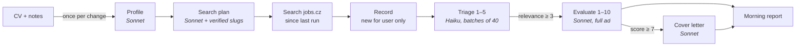

# Job Scout

[](https://github.com/stanislavmatzke-ops/job-scout/actions/workflows/ci.yml)
*[Česká verze](README.cs.md)*

**An AI job-hunting assistant built with .NET 10 and Claude.** Every morning it searches job boards for ads that fit
your CV, filters out the noise, evaluates the rest against your profile and drafts cover letters for the best
matches. **AI pre-selects, the human decides – nothing is ever sent automatically.**

It started as a way to learn applied AI on a real problem: my own job search. Then it became something I use every day.

> **Status:** phases 1–4 are done and in daily use (CLI worker + morning HTML report, run by Windows Task Scheduler).
> Next: web API with Microsoft/Google sign-in, Angular UI, Azure deployment. See [Roadmap](#roadmap).

## What it does

1. **Reads your CV and notes once.** Claude turns a PDF/Markdown CV plus free-text preferences ("full remote,
   min. 95k CZK, no Java") into a structured profile. It runs again only when the CV or the notes change.
2. **Plans the search.** AI suggests the job board's professions that fit the profile. Every suggestion is verified
   against the real site. Verified names are remembered in a learned catalogue, so later runs cost nothing.
3. **Searches daily.** Only ads published since the last successful run (24 h / 3 days) are fetched.
   An ad is stored once and shared by all users. Ads you have already seen are skipped.
4. **Triage (cheap model).** Titles are batched 40 at a time and given a relevance score of 1–5.
   Only the clearly irrelevant ones are dropped.
5. **Evaluation (smart model).** The full ad is fetched. Then come a score of 1–10, reasons, risks and questions to
   ask the employer, plus salary, remote work and contract type. Unknown is not bad: a missing salary is a
   question, not a penalty.
6. **Cover letters** for every match scored 7 or more, written in Czech from the profile and the ad.
7. **Morning report.** A self-contained HTML page shows today's recommendations with "copy letter" buttons,
   earlier matches still waiting for a reaction and borderline ads waiting for your decision.

Every AI call is recorded with its tokens and price. A typical 3-day run costs about **$0.36**, a daily run less.



## Architecture

A **modular monolith** with ports and adapters ([ADR-0002](docs/adr/0002-modular-monolith.md),
[ADR-0003](docs/adr/0003-layering-ports-and-adapters.md)). Dependencies point inwards. Architecture tests
enforce it on every build.

| Project | Responsibility | References |
| --- | --- | --- |
| `JobScout.Core` | Domain: `User`, `UserProfile`, `JobOffer` (shared), `JobMatch` (per user, with status history), `ScoutRun`, `LlmCall` | nothing |
| `JobScout.Application` | Use cases (`AnalyzeProfile`, `PlanSearch`, `TriageJobs`, `EvaluateJobs`, `WriteCoverLetters`, `BuildMorningReport`…), ports (`ILlmClient`, `IJobSource`, `IAppDbContext`), prompts | Core, EF Core base |
| `JobScout.Infrastructure` | Adapters: Claude (official `Anthropic` SDK), jobs.cz (AngleSharp + Playwright fallback), EF Core + SQLite, HTML report | Application |
| `JobScout.Worker` | Host: one-shot run, configuration, DI | all |
| `JobScout.Tests` | xUnit: domain, use cases with fake LLM/job source, parsers on fictional HTML, persistence on real migrations, architecture rules | – |

Design choices worth a look:

- **Own narrow LLM port** ([ADR-0004](docs/adr/0004-own-llm-port.md)). Application code doesn't know the vendor SDK.
  Model *tiers* (`Fast` = Haiku for triage, `Smart` = Sonnet for profile, evaluation and letters) are chosen in config.
- **Structured output** ([ADR-0005](docs/adr/0005-structured-ai-output.md)). Every prompt has a JSON Schema. Results
  are parsed and validated, because LLM output is never trusted blindly (score ranges, unknown ids, cut-off letters).
- **Prompt-injection hygiene.** CVs and job ads are untrusted data. They go inside XML-like tags, and the prompts tell
  the model to ignore instructions found there and report them as a risk.
- **State-driven pipeline.** A `JobMatch` moves through `Found → Shortlisted | TriagedOut → Evaluated`. After a crash
  or a limit, the next run continues where the last one stopped. The work is ordered by relevance, so the best ads
  are evaluated first.
- **Learned catalogue** ([ADR-0015](docs/adr/0015-jobscz-profession-resolution.md)). AI suggests a profession and a
  cheap HTTP check confirms it exists. Both positive and negative answers are cached for 90 days.
- **Cost tracking** ([ADR-0016](docs/adr/0016-llm-cost-tracking.md)). A decorator around `ILlmClient` records every
  call (purpose, model, tokens, micro-dollars, duration). An ambient `AsyncLocal` context assigns it to a user and a run.
- **Rich domain model, EF Core directly** ([ADR-0008](docs/adr/0008-persistence-ef-core.md),
  [ADR-0010](docs/adr/0010-rich-domain-model.md)). No generic repository, no MediatR. Guid v7 ids, `TimeProvider`,
  enums as text, migrations from day one (SQLite now, PostgreSQL in Azure).
- **Polite scraping** ([ADR-0006](docs/adr/0006-job-source-scraping.md)). Public pages only, one request at a time
  with a delay, never internal APIs. A headless browser is used only for JavaScript-rendered career pages.

All decisions, including the rejected alternatives, are in [docs/adr](docs/adr/README.md).

### Where the prompts live

Prompts sit next to the use case that uses them, together with the JSON Schema and the result type they must match:

| Step | Prompt | Model tier |
| --- | --- | --- |
| Profile from CV | `Application/Profiles/ProfilePrompts.cs` | Smart |
| Profession suggestions | `Application/Jobs/CategoryPrompts.cs` | Smart |
| Triage | `Application/Triage/TriagePrompts.cs` | Fast |
| Evaluation | `Application/Evaluation/EvaluationPrompts.cs` | Smart |
| Cover letter | `Application/Letters/CoverLetterPrompts.cs` | Smart |

Prompts and user-facing texts are in Czech (the target market). Code, comments and docs are in English. Prompts are
**profession-neutral**: the test personas include a car painter and a bricklayer, not only developers
([ADR-0014](docs/adr/0014-dev-sign-in-test-personas.md)).

## Running it locally

Requirements: .NET 10 SDK and an [Anthropic API key](https://console.anthropic.com/).

```bash
# API key – environment variable (or user secrets), never in the repo
export ANTHROPIC_API_KEY=...          # Windows: setx ANTHROPIC_API_KEY ...

dotnet test                            # no network, no LLM calls

cd src/JobScout.Worker
# 1) evaluate the fictional sample ads against the fictional sample CV
dotnet run -- --Scout:DataDir=samples
# 2) real search on jobs.cz for a test persona; the HTML report goes to Scout:ReportDir
#    (default: reports/ next to the binaries) and opens in the browser
dotnet run -- --Scout:Persona=zednik --Scout:Mode=search --Scout:OpenReport=true
```

To use your own CV, point `Scout:DataDir` to a folder **outside the repository** with `cv.pdf` (or `cv.md`) and an
optional `preferences.md`, and put the database path in user secrets (`ConnectionStrings:JobScout`). The database
is created and migrated on start.

## Roadmap

| Phase | Content | State |
| --- | --- | --- |
| 1–2 | Claude integration, profile extraction, evaluation; jobs.cz source with browser fallback | ✅ |
| 3 | Persistence, use cases, search plan, learned catalogue, run journal | ✅ |
| 4 | Triage → evaluation → cover letters, cost tracking, morning report | ✅ in daily use |
| 5 | ASP.NET Core API, BFF sign-in with Microsoft/Google, invites, CV upload, statuses | next |
| 6 | Angular UI: all triaged jobs, evaluate / write a letter on demand, status history | |
| 7 | Azure (Container Apps + scheduled job, PostgreSQL, Key Vault), morning e-mail | |
| later | More sources (prace.cz, StartupJobs…), manually added ads ([ADR-0013](docs/adr/0013-manual-job-ads-private.md)), prompt caching | |

## Data and privacy

- No secrets and no personal data in the repository. CVs, sample ads and HTML fixtures are **fictional**.
- Real data (CV, database, reports) lives outside the repository.
- The app never applies for a job or sends anything on your behalf.
- Not affiliated with jobs.cz or LMC. The scraper is meant for personal, low-volume use and respects the site
  (public pages, rate-limited).

## License

[MIT](LICENSE) © 2026 Stanislav Matzke
