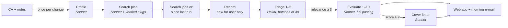
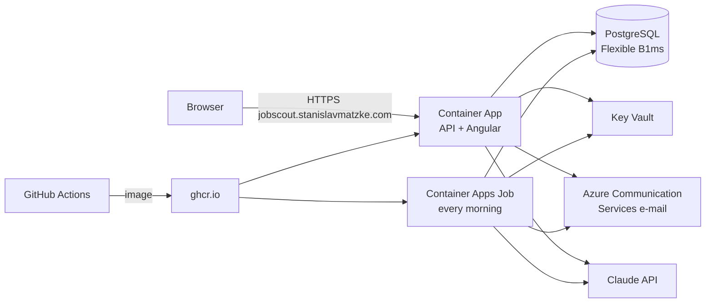

# Job Scout

[](https://github.com/stanislavmatzke-ops/job-scout/actions/workflows/ci.yml)
[](https://github.com/stanislavmatzke-ops/job-scout/actions/workflows/docker.yml)

*[Česká verze](README.cs.md)*

**An AI job-hunting assistant built with .NET 10, Angular and Claude.** Every morning it searches job boards for
postings that fit your CV, filters out the noise, rates the rest against your profile and drafts cover letters for
the best matches. **AI pre-selects, the human decides – nothing is ever sent automatically.**

It started as a way to learn applied AI on a real problem: my own job search. Then it became something I use every day.

> **Live:** [jobscout.stanislavmatzke.com](https://jobscout.stanislavmatzke.com) – click **“Try it without signing up”**
> to look around as a sample user with real, current job postings (AI features are off in the demo).
> Runs in Azure (Container Apps, PostgreSQL), sign-in with Microsoft or Google, UI in Czech and English.

## What it does

1. **Reads your CV and notes once.** Claude turns a CV (PDF, Word, Markdown) plus free-text preferences ("full remote,
   min. 95k CZK, no Java") into a structured profile – in the language of your CV. It runs again only when the CV
   or the notes change.
2. **Plans the search.** AI suggests the job board's professions that fit the profile. Every suggestion is verified
   against the real site. Verified names are remembered in a learned catalogue, so later runs cost nothing.
3. **Searches daily.** Only postings published since the last successful run (24 h / 3 days) are fetched.
   A posting is stored once and shared by all users. Postings you have already seen are skipped.
4. **Triage (cheap model).** Titles are batched 40 at a time and given a relevance score of 1–5.
   Only the clearly irrelevant ones are dropped.
5. **Evaluation (smart model).** The full posting is fetched. Then come a match score of 1–10, reasons, risks and
   questions to ask the employer, plus salary, remote work and contract type. Unknown is not bad: a missing salary is
   a question, not a penalty. The rating is written in the language of the posting (decided in code, not by the model).
6. **Cover letters** for every match scored 7 or more, in the language of the posting.
7. **Web app.** Jobs in tabs (to decide / in progress / closed / filtered out), detail with the AI's rating and letter,
   statuses with history and notes; rate or (re)write a letter on demand; the profile page shows "how the AI sees you".
8. **E-mails.** Every morning a short summary of new jobs (can be turned off), plus access approval/rejection.
9. **Feedback.** A "Feedback" page – the message is stored and e-mailed to the author, who can reply with one click.

Every AI call is recorded with its tokens and price. A typical daily run for one user costs a few cents. What a user
starts by clicking is limited within any 24 hours – profile analyses, letters, evaluations and money – and the UI shows
what is left ([ADR-0021](docs/adr/0021-ai-limits-for-clicks.md)).



## Access

Anyone can sign in with Microsoft or Google; a new account **asks for access** and the admin approves or rejects it
(with a reason, by e-mail) – every approved account costs AI tokens ([ADR-0017](docs/adr/0017-access-requests-admin-approval.md)).
Invitation links skip the queue. Admins see each user's AI cost for the last 7 and 30 days and can suspend an account.
The public **demo account** is one shared fictional user: real postings, no AI for visitors, reset every morning
([ADR-0020](docs/adr/0020-public-demo-account.md)).

## Architecture

A **modular monolith** with ports and adapters ([ADR-0002](docs/adr/0002-modular-monolith.md),
[ADR-0003](docs/adr/0003-layering-ports-and-adapters.md)). Dependencies point inwards. Architecture tests
enforce it on every build.

| Project | Responsibility | References |
| --- | --- | --- |
| `JobScout.Core` | Domain: `User` (access, rejection, suspension), `UserProfile`, `JobOffer` (shared), `JobMatch` (per user, with status history), `ScoutRun`, `LlmCall`, `Invitation` | nothing |
| `JobScout.Application` | Use cases (`AnalyzeProfile`, `RunScout`, `EvaluateMatchNow`, `ApproveUser`…), ports (`ILlmClient`, `IJobSource`, `IEmailSender`, `IAppDbContext`), prompts, e-mail templates | Core, EF Core base |
| `JobScout.Infrastructure` | Adapters: Claude (official `Anthropic` SDK), jobs.cz (AngleSharp + Playwright), EF Core (SQLite locally, PostgreSQL in Azure), Azure Communication Services e-mail | Application |
| `JobScout.Migrations.Postgres` | PostgreSQL migrations (the SQLite ones live in Infrastructure) – [ADR-0018](docs/adr/0018-postgresql-in-azure-sqlite-locally.md) | Infrastructure |
| `JobScout.Api` | ASP.NET Core minimal API: BFF cookie sign-in (OIDC Microsoft/Google), access policies, background queue for the first search, serves the Angular app | all |
| `JobScout.Worker` | The morning run for every approved user (a Container Apps Job in Azure) | all |
| `JobScout.Web` | Angular 21 (standalone, signals, zoneless, Material), Czech/English | – |
| `JobScout.Tests` | xUnit: domain, use cases with fake LLM/job source/e-mail, API in memory, parsers on fictional HTML, both migration sets, architecture rules | – |

Design choices worth a look:

- **Own narrow LLM port** ([ADR-0004](docs/adr/0004-own-llm-port.md)). Application code doesn't know the vendor SDK.
  Model *tiers* (`Fast` = Haiku for triage, `Smart` = Sonnet for profile, evaluation and letters) are chosen in config.
- **Structured output** ([ADR-0005](docs/adr/0005-structured-ai-output.md)). Every prompt has a JSON Schema. Results
  are parsed and validated, because LLM output is never trusted blindly (score ranges, unknown ids, cut-off letters).
- **Prompt-injection hygiene.** CVs and job postings are untrusted data. They go inside XML-like tags, and the prompts
  tell the model to ignore instructions found there and report them as a risk.
- **State-driven pipeline.** A `JobMatch` moves through `Found → Shortlisted | TriagedOut → Evaluated`. After a crash
  or a limit, the next run continues where the last one stopped – best postings first.
- **Cost tracking** ([ADR-0016](docs/adr/0016-llm-cost-tracking.md)). A decorator around `ILlmClient` records every
  call (purpose, model, tokens, micro-dollars, duration). An ambient `AsyncLocal` context assigns it to a user and a run.
- **BFF sign-in** ([ADR-0011](docs/adr/0011-authentication-bff.md)). The browser never sees a token: OIDC with
  Microsoft/Google ends in our own `__Host-` cookie; state-changing calls need an `X-CSRF` header. Access status is read
  from the database on every request, so approving or suspending takes effect immediately.
- **Rich domain model, EF Core directly** ([ADR-0008](docs/adr/0008-persistence-ef-core.md),
  [ADR-0010](docs/adr/0010-rich-domain-model.md)). No generic repository, no MediatR. Guid v7 ids, `TimeProvider`,
  enums as text, migrations from day one.
- **Typed i18n without a library.** Czech is the source dictionary, English is `typeof cs` – the compiler refuses a
  missing translation. The language follows the browser, the user's choice is remembered.
- **Polite scraping** ([ADR-0006](docs/adr/0006-job-source-scraping.md)). Public pages only, one request at a time
  with a delay, never internal APIs.

All decisions, including the rejected alternatives, are in [docs/adr](docs/adr/README.md).

### Hosting



One Docker image (Angular + API + Worker + headless Chromium) built by GitHub Actions; the whole Azure environment is
**infrastructure as code** in [`infra/main.bicep`](infra/main.bicep) and deployed with one script
([ADR-0019](docs/adr/0019-hosting-one-image-container-apps.md), [infra/README.md](infra/README.md)). Secrets live in
Key Vault and are read through a managed identity; nothing personal is in the repository.

### Where the prompts live

| Step | Prompt | Model tier |
| --- | --- | --- |
| Profile from CV | `Application/Profiles/ProfilePrompts.cs` | Smart |
| Profession suggestions | `Application/Jobs/CategoryPrompts.cs` | Smart |
| Triage | `Application/Triage/TriagePrompts.cs` | Fast |
| Evaluation | `Application/Evaluation/EvaluationPrompts.cs` | Smart |
| Cover letter | `Application/Letters/CoverLetterPrompts.cs` | Smart |

Prompts are in Czech (the target market); the output follows the language of the source (CV or posting). Code,
comments and docs are in English. Prompts are **profession-neutral**: the test personas include a car painter and a
bricklayer, not only developers ([ADR-0014](docs/adr/0014-dev-sign-in-test-personas.md)).

## Running it locally

Requirements: .NET 10 SDK, Node 22 (npm 11) and an [Anthropic API key](https://console.anthropic.com/).

```bash
export ANTHROPIC_API_KEY=...          # Windows: setx ANTHROPIC_API_KEY ...   – never in the repo

dotnet test                            # no network, no LLM calls
cd src/JobScout.Web && npm ci && npm test

# API (https://localhost:7283, SQLite file, dev sign-in with test personas)
dotnet run --project src/JobScout.Api --launch-profile https
# Angular (https://localhost:4200, proxies /api to the API)
cd src/JobScout.Web && npm start

# The morning run for a test persona from the console
dotnet run --project src/JobScout.Worker -- --Scout:Persona=zednik --Scout:Mode=search
```

Microsoft/Google sign-in needs your own OAuth clients in the API's user secrets (`Auth:Microsoft:*`, `Auth:Google:*`);
without them the login page offers only the test personas. E-mails are only logged locally.

## Roadmap

| Phase | Content | State |
| --- | --- | --- |
| 1–4 | Claude integration, jobs.cz source, persistence, triage → evaluation → cover letters, cost tracking | ✅ |
| 5 | ASP.NET Core API, BFF sign-in with Microsoft/Google, access requests and admin approval, invitations | ✅ |
| 6 | Angular UI: jobs, detail, AI on demand, profile, admin panel, Czech/English | ✅ |
| 7 | Azure: Container Apps + morning job, PostgreSQL, Key Vault, custom domain, e-mails, Bicep | ✅ live |
| 8 | Demo account, first real users | ✅ demo / in progress |
| later | More sources (prace.cz, StartupJobs…), manually added postings ([ADR-0013](docs/adr/0013-manual-job-ads-private.md)), prompt caching, evals for prompts | |

## Data and privacy

- No secrets and no personal data in the repository. CVs, sample postings, the demo user and HTML fixtures are **fictional**.
- Production data lives in Azure (EU – Germany West Central / Poland Central); contact details from the CV are not stored in the profile.
- The app never applies for a job or sends anything on your behalf.
- Not affiliated with jobs.cz or LMC. The scraper is meant for low-volume use and respects the site (public pages, rate-limited).

## License

[MIT](LICENSE) © 2026 Stanislav Matzke
